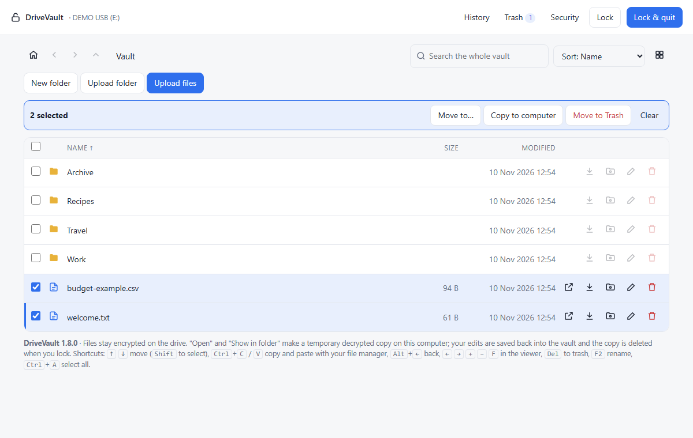
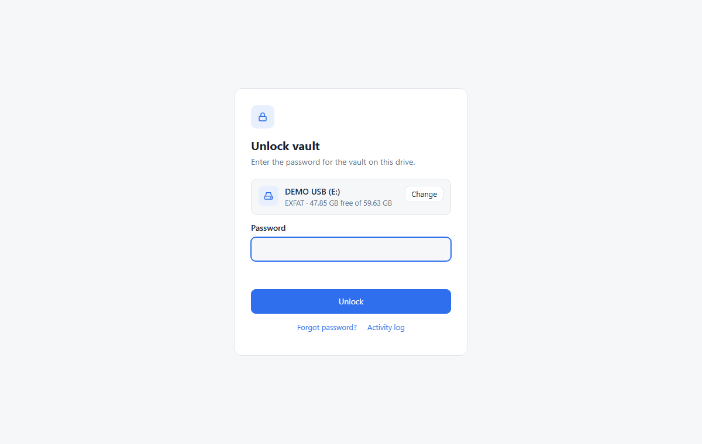
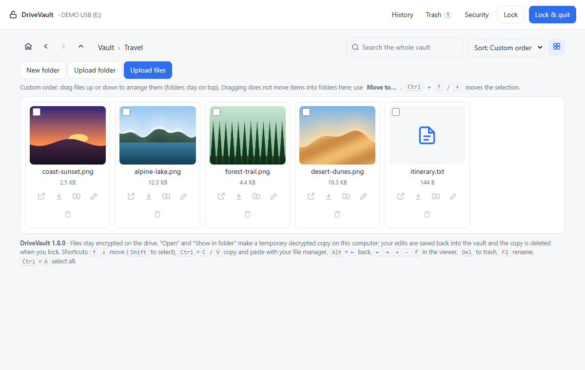
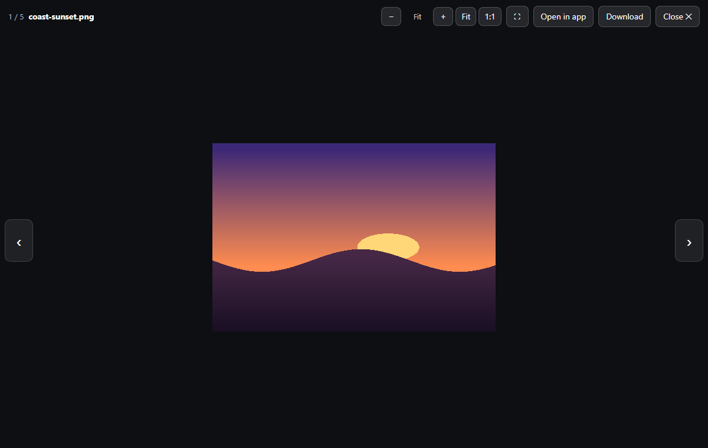
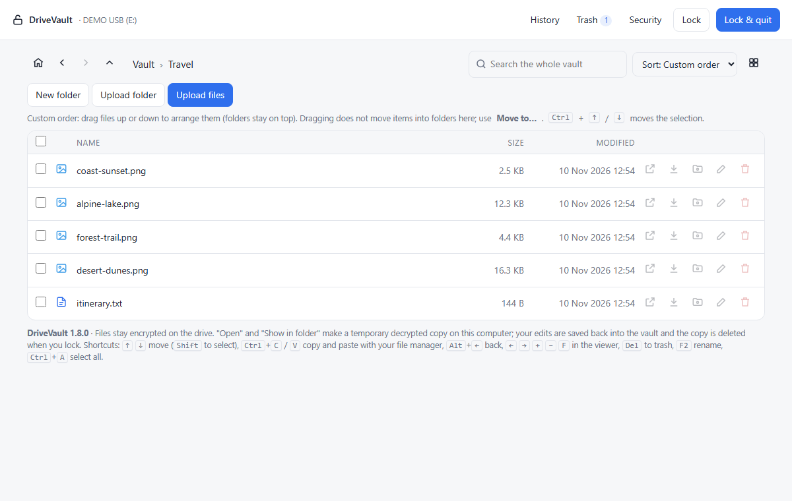
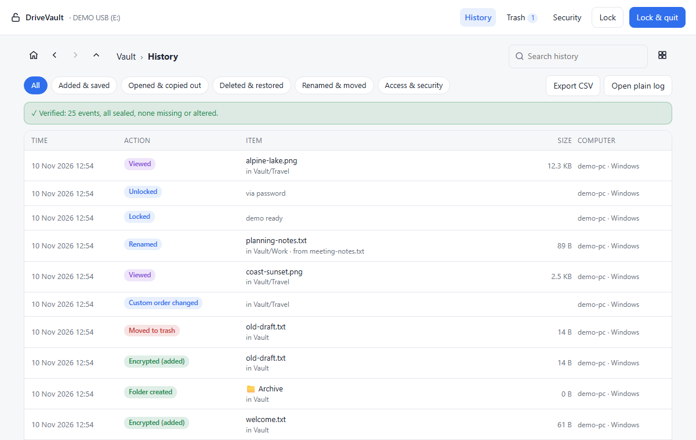
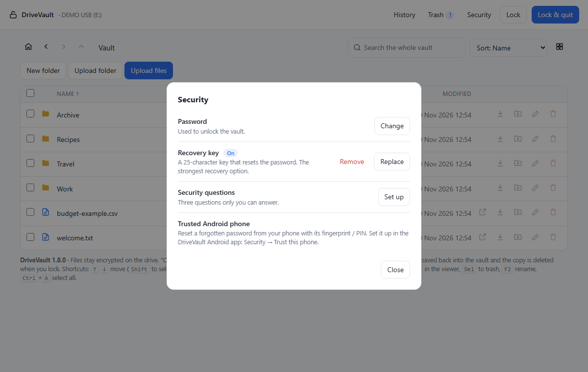

# DriveVault

**A password-protected, encrypted vault on a USB drive that opens on Windows, Linux and Android with the same password.**

You put files into the vault and DriveVault encrypts them before they reach the drive. Without the password the drive
holds only unreadable blobs: no file names, no folder structure, no contents. The drive stays a normal exFAT disk, and the
program travels on it, so you can plug it into another computer and open your files there.



> DriveVault is a personal open-source project and has **not been independently audited**. Keep backups and read
> [SECURITY.md](SECURITY.md) before you trust it with anything important.

## Why

Ordinary USB drives are easy to lose. Full-disk encryption tools often need administrator rights or software installed
on every computer, and usually don't work on phones. DriveVault keeps an encrypted folder on a plain exFAT drive and
brings its own small program along, so the same vault opens on a Windows PC, a Linux PC and an Android phone.

## Features

- Files, file names and folders are encrypted (AES-256-GCM); the password is protected with Argon2id
- One vault, three platforms: Windows and Linux (desktop app on the drive) and Android (app)
- Built-in viewer for photos, video, audio, PDF, Word (.docx), CSV and text, with zoom, full screen and next / previous
- List and grid view with photo thumbnails (made in memory, never saved to disk)
- Upload files and folders, drag and drop, Ctrl+V / Ctrl+C with your file manager
- Search, rename, move, custom order, trash with restore (nothing is deleted automatically)
- "Open in app": edit a file in its normal program; the changes are encrypted back into the vault when you lock
- Videos and music stream into VLC or mpv on the desktop, and into other apps on Android, without a decrypted copy on disk
- Encrypted, tamper-evident history of what was added, opened, copied out, renamed, moved and deleted
- Password recovery with a recovery key, security questions, or a trusted Android phone
- Progress with percentage, speed and time left; auto-lock

More detail: [docs/FEATURES.md](docs/FEATURES.md).

| | | |
|---|---|---|
|  |  |  |
|  |  |  |

*Screenshots of the real desktop app with fictional demo data ([how to make them](docs/DEVELOPMENT.md#demo-data-and-screenshots)).*

## Install

Short version below; step by step with permissions, updating and uninstalling: [docs/INSTALLATION.md](docs/INSTALLATION.md).

1. **Drive:** format the USB drive as **exFAT** so Windows, Linux and Android can all read it (formatting erases it).
2. **Desktop:** download `DriveVault-v1.8.0.zip` from [Releases](https://github.com/svrsunny/DriveVault/releases) and
   extract it to the root of the drive.

   | System | Start | Needs |
   |---|---|---|
   | Windows | double-click `Open Vault (Windows).bat` | Python 3 from python.org |
   | Linux | `sh open-vault-linux.sh` | Python 3; the script installs the `cryptography` package |

   DriveVault opens in your browser on a page that only this computer can reach.
3. **Android (8.0 or newer):** install `DriveVault-Android-v1.8.0.apk` from
   [Releases](https://github.com/svrsunny/DriveVault/releases), allow *All files access*, plug in the drive and pick it.

## Quick start

1. Start DriveVault and check that the drive shown is your USB drive (press **Change** if not).
2. Choose a password (4–5 random words work well) and **save the recovery key** somewhere away from the drive.
3. Drag files into the window or press **Upload files**. They are encrypted onto the drive.
4. Click a file to view it. Press **Lock & quit** before you unplug the drive.

To try DriveVault without a USB drive, run the demo with fictional files: `python tools/demo.py` (needs Python and
`pip install cryptography`).

Full guide: [docs/USER_GUIDE.md](docs/USER_GUIDE.md).

## Privacy and security in short

- Everything inside the vault is encrypted on the drive. Lose the password **and** every recovery method and the data is gone.
- DriveVault has no accounts, no cloud and no telemetry. The desktop app only listens on `127.0.0.1`; the Android app
  has no internet permission. The launchers download Python packages the first time they run.
- Not hidden: the number and rough size of files, and `DriveVault/activity.log`, a plain-text log of actions with the
  computer name and user name (file names only if you turn that on).
- "Open in app" and "Copy to computer" put decrypted copies on that computer.

Details: [SECURITY.md](SECURITY.md), [PRIVACY.md](PRIVACY.md), [docs/SECURITY_REVIEW.md](docs/SECURITY_REVIEW.md).

## Known limitations

- Not independently audited; personal project with one maintainer.
- No macOS launcher. The desktop app needs Python 3 on the computer.
- Windows builds are not code-signed, and the APK is not on Google Play (you install it yourself).
- Malware on a computer or phone can read your files while the vault is unlocked there.

More: [docs/FAQ.md](docs/FAQ.md) and [docs/TROUBLESHOOTING.md](docs/TROUBLESHOOTING.md).

## How it is built

| Part | Technology |
|---|---|
| Desktop app | Python 3 standard library + [`cryptography`](https://cryptography.io); a local web server and a single-page UI (`ui.html`) |
| Android app | Kotlin, Jetpack Compose, Media3 (video), Bouncy Castle (Argon2id) |
| Vault format | Shared byte-level spec: [docs/FORMAT.md](docs/FORMAT.md); both apps read and write the same vault |
| Tests | Python unit, API and Playwright browser tests; Kotlin and Robolectric tests; a Python ⇄ Kotlin compatibility test |

```
DriveVault/
├── desktop/              what goes on the drive (launchers, short guide, app/)
│   └── app/              drivevault.py (server), vaultcore.py (format + crypto), ui.html (interface)
├── android/              Android app: core/ (vault format in Kotlin) and app/ (UI, storage, viewer)
├── docs/                 user and developer documentation, format spec
├── tests/                all tests; run_all.py runs everything
├── tools/                demo.py (fictional demo vault), screenshots.py
└── assets/screenshots/   README images
```

Architecture: [docs/ARCHITECTURE.md](docs/ARCHITECTURE.md) · Building and testing: [docs/DEVELOPMENT.md](docs/DEVELOPMENT.md) ·
Releases: [docs/RELEASING.md](docs/RELEASING.md)

## Contributing

Bug reports and pull requests are welcome. Please read [CONTRIBUTING.md](CONTRIBUTING.md) and the
[Code of Conduct](CODE_OF_CONDUCT.md). Report security problems privately as described in [SECURITY.md](SECURITY.md).

## License

[MIT](LICENSE). Bundled and linked third-party components: [THIRD_PARTY_NOTICES.md](THIRD_PARTY_NOTICES.md).
