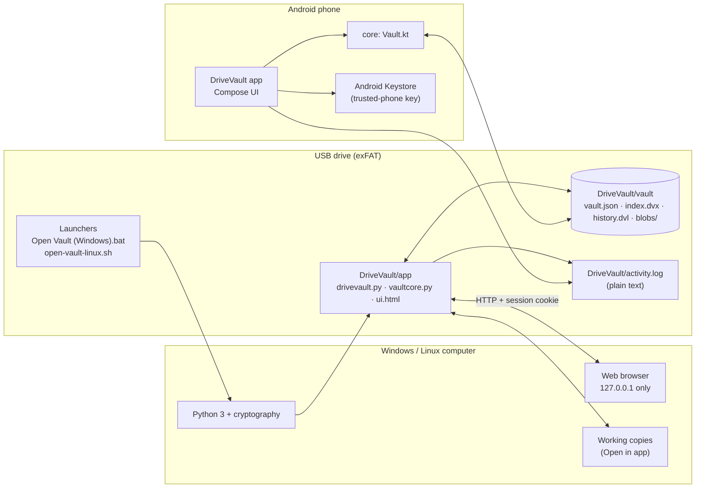
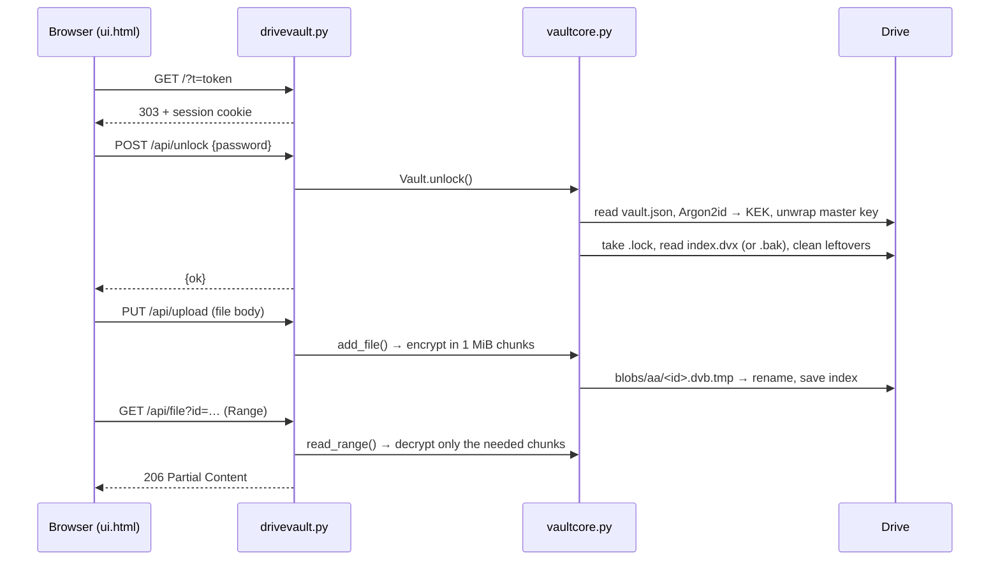

# Architecture

DriveVault is two independent programs that read and write the same on-disk format:

- the **desktop app** (Python), which lives on the drive and serves a local web page, and
- the **Android app** (Kotlin), whose `core` module implements the same format byte for byte.

The format is the contract between them: [FORMAT.md](FORMAT.md). A compatibility test checks that each side reads and
writes what the other produces.



## Desktop app (`desktop/app`)

| File | Role |
|---|---|
| `vaultcore.py` | The vault format: key derivation, AES-GCM, index, blobs, history, recovery slots, the single-instance lock and leftover clean-up. No network, no UI. |
| `drivevault.py` | A `ThreadingHTTPServer` bound to `127.0.0.1` on a random port. Handles the JSON API (`/api/...`), file streaming with range requests, working copies ("Open in app"), the plain activity log, drive detection, clipboard integration and auto-lock. |
| `ui.html` | The whole interface: one HTML file with inline CSS and JavaScript, no build step. |
| `mammoth.min.js` | Converts .docx to HTML in the viewer. |

Startup: the launcher finds Python, makes sure `cryptography` (and Argon2 support) is installed and runs
`drivevault.py`. The server prints a one-time URL with a random token and opens the browser. The first request trades the
token for an `HttpOnly`, `SameSite=Strict` cookie; every later request needs that cookie and a `Host` header of
`127.0.0.1:<port>` or `localhost:<port>`.



## Android app (`android/`)

| Module / file | Role |
|---|---|
| `core/Vault.kt` | The format in Kotlin (same bytes as `vaultcore.py`), on top of `VaultFs` |
| `core/VaultFs.kt` | Storage interface; `FileFs` is plain `java.io.File` |
| `app/SafFs.kt` | `VaultFs` over a folder picked with the Storage Access Framework |
| `app/Storage.kt` | Finds drives, decides whether a drive holds a vault, is empty, or isn't ready; imports files |
| `app/Session.kt` | App state: current drive and vault, lock / unlock, history and plain log, background jobs, error messages |
| `app/VaultProvider.kt` | `content://` links that decrypt on demand for "Open with" and "Share" (no copy written) |
| `app/VaultDataSource.kt` | Media3 data source that plays video and audio straight from the vault |
| `app/DeviceTrust.kt` | Trusted phone: a random device key encrypted by an Android Keystore key that needs the screen lock |
| `app/Thumbs.kt` | In-memory thumbnail cache, cleared on lock |
| `app/ui/*` | Jetpack Compose screens: drive list, lock screen, browser, viewer, history, security |

## Data on the drive

```
<drive>/
├── Open Vault (Windows).bat  open-vault-linux.sh  READ ME - DriveVault.txt
└── DriveVault/
    ├── app/            the desktop program (replaced when updating)
    ├── vault/          encrypted data: vault.json, index.dvx(.bak), history.dvl, blobs/<aa>/<id>.dvb
    └── activity.log    plain-text activity log
```

Writes go to a temporary file first and are renamed into place; the index keeps a `.bak` copy and readers take the newer
valid one. Details, including every key derivation and AAD string, are in [FORMAT.md](FORMAT.md).
